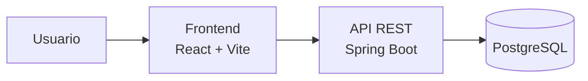
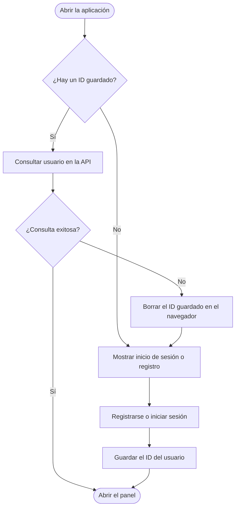
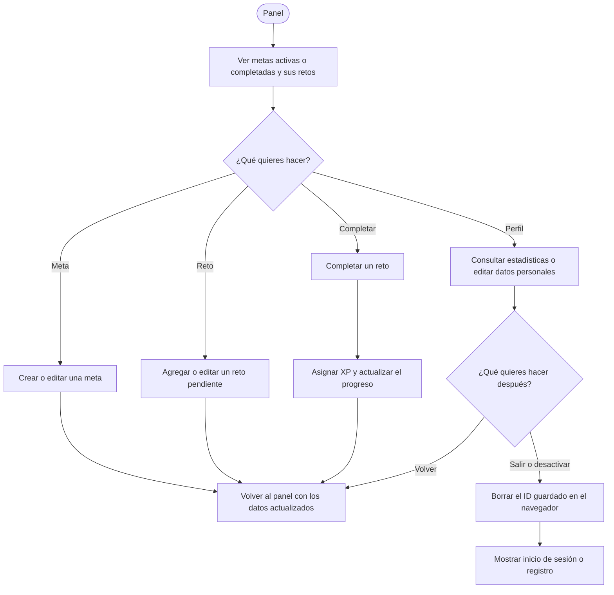

# AI LifeQuest


AI LifeQuest convierte metas personales en una experiencia tipo juego. Cada usuario crea metas, las divide en retos y gana XP al completarlos. El proyecto incluye una aplicación web, una API REST y una base de datos PostgreSQL.

## Funcionalidades

- Registrar una cuenta e iniciar sesión.
- Restaurar el acceso al panel después de recargar la aplicación.
- Crear y editar metas personales.
- Crear y editar retos asociados a una meta.
- Completar retos, ganar XP y actualizar el progreso de la meta.
- Consultar metas activas y completadas, además de estadísticas del perfil.
- Editar los datos del perfil o desactivar la cuenta conservando su historial.

## Arquitectura



El frontend consulta la API para leer y actualizar los datos persistidos en PostgreSQL. El flujo principal no depende de datos de demostración guardados en el navegador.

## Flujo de uso

### Acceso y restauración de la sesión



Al registrarse o iniciar sesión, el backend devuelve los datos del usuario y el frontend guarda su `userId` en `localStorage`; después abre el panel. Al iniciar o recargar la aplicación, si ya hay un ID guardado, consulta `GET /api/users?userId=...`. Si esa consulta falla, elimina el ID del navegador y muestra el acceso. Esto no elimina la cuenta ni sus datos. La API no entrega un token de sesión.

### Acciones dentro de la aplicación



Crear o editar una meta y agregar o editar un reto pendiente son operaciones independientes. Al guardar, la aplicación vuelve al panel. Al completar un reto, el backend registra la recompensa de XP, actualiza el progreso de la meta y devuelve los datos actualizados. El perfil calcula estadísticas a partir de las metas y retos. Cerrar sesión borra el ID guardado; desactivar la cuenta también cierra la sesión y conserva el historial del usuario.

## Estructura del repositorio

```text
AILifeQuest/
├── ai-lifequest-backend/    # API REST con Spring Boot
├── ai-lifequest-frontend/   # Interfaz web con React + Vite
├── docs/                    # Diagramas del sistema y flujos
└── README.md                # Guía principal del proyecto
```

## Tecnologías

**Frontend**

- React y TypeScript
- Vite
- Axios
- Lucide React

**Backend**

- Java 17 y Spring Boot 3
- Spring Web y Spring Data JPA
- PostgreSQL
- Maven

## Requisitos

- Java 17
- Maven
- Node.js y npm
- Docker Desktop o Docker Engine con Docker Compose

La configuración local de PostgreSQL, incluidos los valores predeterminados y la alternativa sin Docker, está documentada en [ai-lifequest-backend/README.md](ai-lifequest-backend/README.md).

## Ejecutar el proyecto

Abre tres terminales desde la raíz del repositorio.

### 1. Base de datos

```bash
docker compose up -d postgres
```

Docker publica PostgreSQL en `localhost:5433` por defecto.

### 2. Backend

```bash
cd ai-lifequest-backend
mvn spring-boot:run
```

La API queda disponible en `http://localhost:8080`. Por defecto, se conecta a la base `lifequest_db` en `localhost:5433`.

### 3. Frontend

```bash
cd ai-lifequest-frontend
npm install
npm run dev
```

Abre `http://localhost:5173`. El frontend usa `http://localhost:8080/api` por defecto. Para usar otra dirección, configura `VITE_API_BASE_URL` con la URL base de la API, incluido `/api`.

## Probar el flujo desde la aplicación

1. Abre `http://localhost:5173` y regístrate o inicia sesión.
2. Crea una meta desde el panel.
3. Agrega uno o más retos a esa meta.
4. Completa un reto y verifica que aumenten la XP y el progreso de la meta.
5. Recarga la página y verifica que se restaure el acceso al panel.
6. Desde el perfil, prueba editar los datos o desactivar la cuenta.

## API principal

La URL base local es `http://localhost:8080`. Los endpoints reciben y devuelven JSON cuando hay un cuerpo de solicitud o respuesta. Los identificadores son UUID. Los campos opcionales de actualización pueden omitirse; los campos de asociación indicados como requeridos deben enviarse incluso en una actualización.

### Autenticación

| Método | Endpoint | Solicitud | Respuesta |
| --- | --- | --- | --- |
| `POST` | `/api/auth/register` | `name`, `email`, `password` | Usuario creado (`201 Created`) |
| `POST` | `/api/auth/login` | `email`, `password` | Usuario autenticado (`200 OK`) |

El registro exige nombre, email válido y contraseña de 6 a 128 caracteres. La respuesta de ambos endpoints contiene `userId`, `name`, `email`, `totalXp` y `status`.

### Usuarios

| Método | Endpoint | Solicitud | Respuesta |
| --- | --- | --- | --- |
| `GET` | `/api/users?userId={userId}` | Query `userId` | Usuario (`200 OK`) |
| `PATCH` | `/api/users/{userId}` | JSON con `name` y/o `email` | Usuario actualizado (`200 OK`) |
| `PATCH` | `/api/users/{userId}/deactivate` | Sin cuerpo | Usuario desactivado (`200 OK`) |

La desactivación no elimina metas, retos ni XP del usuario. Una cuenta inactiva no puede crear metas ni retos.

### Metas

| Método | Endpoint | Solicitud | Respuesta |
| --- | --- | --- | --- |
| `POST` | `/api/goals` | `userId`, `title`, `category`, `targetDate`; `description` opcional | Meta creada (`201 Created`) |
| `GET` | `/api/goals?userId={userId}` | Query `userId` | Lista de metas (`200 OK`) |
| `PATCH` | `/api/goals/{goalId}` | `userId` requerido; `title`, `description`, `category`, `targetDate` opcionales | Meta actualizada (`200 OK`) |

### Retos

| Método | Endpoint | Solicitud | Respuesta |
| --- | --- | --- | --- |
| `POST` | `/api/challenges` | `goalId`, `title`, `xpReward`; `description` opcional | Reto creado (`201 Created`) |
| `GET` | `/api/challenges?goalId={goalId}` | Query `goalId` | Lista de retos (`200 OK`) |
| `PATCH` | `/api/challenges/{challengeId}` | `goalId` requerido; `title`, `description`, `xpReward` opcionales | Reto actualizado (`200 OK`) |
| `PATCH` | `/api/challenges/complete` | JSON con `challengeId` | Usuario, meta, reto y XP ganada (`200 OK`) |

La recompensa `xpReward` debe ser al menos `1`. El cuerpo para completar un reto es `{"challengeId":"<UUID>"}`. Completar un reto ya completado o bloqueado devuelve un error de solicitud; no asigna XP otra vez.

Al crear un reto, `goalId` debe identificar una meta existente. En las actualizaciones, `userId` debe identificar al propietario de la meta y `goalId` debe corresponder al reto. Las solicitudes inválidas responden con `400`, las credenciales incorrectas con `401`, los recursos inexistentes con `404` y los conflictos como emails o títulos duplicados con `409`.
